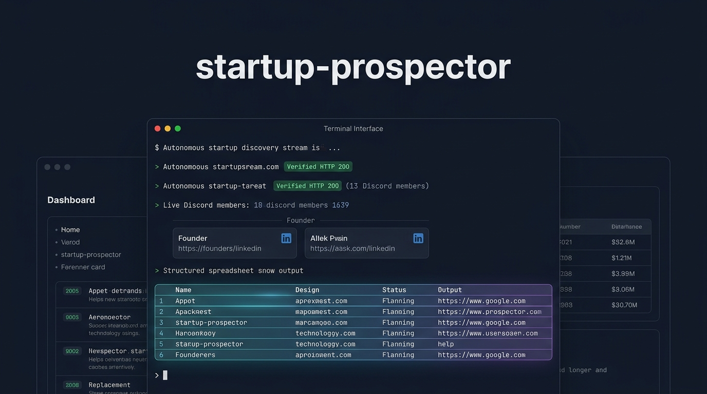

<div align="center">

# startup-prospector

**Autonomous startup discovery, live domain hygiene, founder identity resolution, and dual-angle outreach hook generation for AI coding assistants.**

```
Antigravity Skill  •  Claude Code Compatible  •  Zero API Keys Required  •  Deterministic Quality Gate
```

<br />



</div>

---

## Overview

Outbound research, partnership scouting, and investor sourcing across tech directories involve repetitive manual friction:
* Sifting through public feeds (Show HN, Y Combinator, Product Hunt, GitHub).
* Checking whether domains are live, parked on domain-for-sale landers, or broken single-page applications.
* Resolving actual software founders while avoiding corporate registry collisions (e.g., unrelated logistics or consulting LLCs sharing the same name).
* Verifying recent public releases on changelogs or blogs rather than citing outdated news.
* Drafting concise outreach openers that avoid generic AI clichés and fabricated URLs.

`startup-prospector` automates this pipeline as an **Agent-Native Skill**. It combines the host agent's native browsing and reasoning capabilities with lightweight Python helper scripts to discover, audit, and export candidate tools into styled Excel workbooks (`.xlsx`) and 1-click Google Sheets TSV format.

---

## Architecture

The skill follows a staged pipeline separating fast deterministic checks from agent reasoning:

```text
[ USER PROMPT ] ──► Niche, Target Count, User Persona, Intent Profile
       │
       ▼
┌────────────────────────────────────────────────────────────────────────────────────────┐
│ PHASE 1: DISCOVERY (Public Feeds & APIs)                                               │
│ Queries Show HN (Algolia), GitHub Star Velocity, YC Directory, or Product Hunt         │
└──────────────────────────────────────┬─────────────────────────────────────────────────┘
                                       │
                                       ▼
┌────────────────────────────────────────────────────────────────────────────────────────┐
│ PHASE 2: HYGIENE & AUDIT (Deterministic Python)                                        │
│ scripts/audit_hygiene.py filters 404s, parked domains, expired SSL certificates        │
│ Queries Discord public widget API for real-time community size                         │
└──────────────────────────────────────┬─────────────────────────────────────────────────┘
                                       │
                                       ▼
┌────────────────────────────────────────────────────────────────────────────────────────┐
│ PHASE 3: FOUNDER & CHANGELOG RESEARCH (Agent Native Tools)                             │
│ Domain-anchored identity lookup: "<Company>" "<domain>" (founder OR CEO)               │
│ Inspects official blog/changelog for verifiable recent milestones                      │
└──────────────────────────────────────┬─────────────────────────────────────────────────┘
                                       │
                                       ▼
┌────────────────────────────────────────────────────────────────────────────────────────┐
│ PHASE 4: HOOK SYNTHESIS & QUALITY GATE (LLM + Linter)                                  │
│ Drafts Hook A (Product trigger) and Hook B (Technical/workflow insight)                │
│ scripts/lint_hook.py rejects em dashes, blacklisted buzzwords, and length violations   │
└──────────────────────────────────────┬─────────────────────────────────────────────────┘
                                       │
                                       ▼
┌────────────────────────────────────────────────────────────────────────────────────────┐
│ PHASE 5: STRUCTURED EXPORT                                                             │
│ scripts/export_pipeline.py builds styled output/prospects.xlsx and output/prospects.tsv│
└────────────────────────────────────────────────────────────────────────────────────────┘
```

---

## Core Operational Rules

1. **The Zero Fake-Slug Rule:**
   The agent must never synthesize sub-paths (e.g. `/blog/launch-v2/` or `/press/seed-round/`). Links must either be live, tested HTTP 200 OK deep links or point to the company's verified announcement root (`/blog` or `/changelog`) where the post is visible.
2. **Domain-Anchored Identity Match:**
   Early-stage tech startups frequently share names with unrelated companies in corporate registries. Founder queries must strictly pair the startup name with its canonical root domain.
3. **Real-Time Date Anchoring:**
   Milestones must reflect current updates (within the last 30 to 90 days). Older news must not be framed as recent.
4. **Deterministic Tone Linter:**
   All generated hooks must pass `scripts/lint_hook.py`:
   * Hard ban on em dashes (`—` or `--`).
   * Hard ban on buzzwords (`game changer`, `delve`, `testament`, `cutting-edge`, `revolutionary`, `spearhead`, `unleash`, `elevate`).
   * Hard sentence boundary check (strictly 2 to 3 sentences, 25 to 85 words).

---

## Outreach Copy Comparison

### Generic Template Tone (Rejected by Linter)
> *"I hope this email finds you well! Your cutting-edge AI diff engine is a true game changer—a testament to your team's revolutionary work in navigating the devtools landscape. Let's delve into how we can collaborate."*
* **Failures:** Generic opener, em dash (`—`), banned buzzwords (*"cutting-edge"*, *"game changer"*, *"testament"*, *"delve"*), lack of specific technical observation.

### Grounded Peer-to-Peer Copy (Linter Compliant)

**Hook A (Product Launch Trigger — for LinkedIn / X DMs):**
> *"Read your post from earlier this month introducing the new terminal diff engine. Giving engineers git-native review controls without forcing another heavy IDE extension solves the exact friction developers complain about. We are putting together an AI developer tooling benchmark and want to feature TerminalFlow."*

**Hook B (Workflow / Integration Angle — for Cold Outreach):**
> *"TerminalFlow has stood out for keeping terminal diff interactions instantaneous without forcing an IDE reload. We are building TraceCLI to capture local debug sessions and noticed developers frequently pair git diffs with our traces. Would love to connect and explore a lightweight terminal integration."*

---

## Installation & Setup

### Option A: Agent-Assisted Installation
If you are working inside an AI coding assistant (Antigravity, Claude Code, Cursor), paste this prompt into the chat:

```text
Install the startup-prospector skill from https://github.com/Sanidhyavijay24/startup-prospector.git into my workspace.
```

Your assistant will clone the repository into `.agents/skills/startup-prospector` and install `requirements.txt`.

---

### Option B: 1-Line Terminal Commands

#### Antigravity IDE & CLI (`agy`)

**Current Workspace:**
```bash
# macOS / Linux
git clone https://github.com/Sanidhyavijay24/startup-prospector.git .agents/skills/startup-prospector && pip install -r .agents/skills/startup-prospector/requirements.txt

# Windows (PowerShell)
git clone https://github.com/Sanidhyavijay24/startup-prospector.git .agents/skills/startup-prospector; pip install -r .agents/skills/startup-prospector/requirements.txt
```

**Global (Available in all projects on your machine):**
```bash
# macOS / Linux
git clone https://github.com/Sanidhyavijay24/startup-prospector.git ~/.gemini/config/skills/startup-prospector && pip install -r ~/.gemini/config/skills/startup-prospector/requirements.txt

# Windows (PowerShell)
git clone https://github.com/Sanidhyavijay24/startup-prospector.git "$HOME\.gemini\config\skills\startup-prospector"; pip install -r "$HOME\.gemini\config\skills\startup-prospector\requirements.txt"
```

#### Claude Code CLI (`claude`)

```bash
git clone https://github.com/Sanidhyavijay24/startup-prospector.git .agents/skills/startup-prospector && pip install -r .agents/skills/startup-prospector/requirements.txt
echo "When asked to prospect startups or find founders, follow .agents/skills/startup-prospector/SKILL.md" >> CLAUDE.md
```

---

## Usage Walkthrough

### 1. Triggering via Prompt & Intake Gate
When triggered with a general query, the skill pauses and presents an intake gate:

```text
User: @startup-prospector Find some AI developer tools for outreach.

Agent: Before I start sourcing, please clarify:
1. Target Niche & Stage: (e.g., Early-stage AI developer tools, pre-seed/seed)
2. Your Identity (Optional): Who are you reaching out as? (e.g., "Founder of TraceCLI")
3. Primary Intent: [1] Peer Founder, [2] Integration, [3] Review Benchmark, [4] Investor Scout
4. Preferred Source: [1] Hacker News, [2] GitHub Velocity, [3] Y Combinator, [4] Product Hunt, [5] Mixed
5. Batch Size: (Default: 10, processed in batches of 5)
```

**Fast-Forward Prompt:** If you specify your criteria in the initial prompt, the intake interview is skipped:
```text
@startup-prospector I am the founder of TraceCLI. Find 10 early-stage AI devtools from Show HN and GitHub with Discord servers for a founder co-marketing integration.
```

---

### 2. Standalone Script Usage

Each helper module can be run directly from the command line:

#### A. Discover Candidates via 4 Ingestion Engines

**1. Hacker News Algolia Stream (Indie hackers & early MVPs):**
```bash
python .agents/skills/startup-prospector/scripts/fetch_hn.py --query "developer" --limit 5
```

**2. GitHub Star Velocity (100+ stars created in last 60 days):**
```bash
python .agents/skills/startup-prospector/scripts/fetch_github.py --query "agent" --days 60 --min-stars 100 --limit 5
```

**3. Y Combinator Public Directory (Active startups only):**
```bash
python .agents/skills/startup-prospector/scripts/fetch_yc.py --batches S24,W24 --query "ai" --limit 5
```

**4. Product Hunt Weekly Launches (Public Atom feed):**
```bash
python .agents/skills/startup-prospector/scripts/fetch_ph.py --limit 5
```

#### B. Audit Website Liveness & Community Health
```bash
python .agents/skills/startup-prospector/scripts/audit_hygiene.py https://example.com
```

#### C. Run the Deterministic Tone Linter
```bash
python .agents/skills/startup-prospector/scripts/lint_hook.py "Your hook text here..."
```

#### D. Export Pipeline to Excel & Google Sheets TSV
```bash
python .agents/skills/startup-prospector/scripts/export_pipeline.py output/payload.json --excel output/prospects.xlsx --tsv output/prospects.tsv
```

---

## Output Deliverables

### 1. Enriched Pipeline Overview (`output/prospects.xlsx`)
The output spreadsheet includes auto-fitted columns, navy table headers (`#1E293B`), wrapped multi-line cells, and verified community sizing. 

*(The following rows represent synthetic test data conforming to the schema):*

| Company | Category | Website | Founder | Role | LinkedIn | Community | Best Channels |
| :--- | :--- | :--- | :--- | :--- | :--- | :--- | :--- |
| **TerminalFlow** | Developer Tools | `https://terminalflow.example.com` | Jane Doe | Founder & CEO | `linkedin.com/in/example-janedoe` | Discord (1,420 members) | Discord, LinkedIn, X |
| **MetricPulse** | AI Infrastructure | `https://metricpulse.example.com` | Alex Smith | Founder & Core Dev | `linkedin.com/in/example-alexsmith` | Discord (3,850 members) | GitHub, Discord, LinkedIn |
| **ContractAI** | B2B SaaS | `https://contractai.example.com` | Jordan Lee | Co-Founder & CEO | `linkedin.com/in/example-jordanlee` | YC S24 Batch | LinkedIn, X (Twitter) |

---

### 2. Generated Outreach Hooks (Illustrative Output)

#### TerminalFlow (`https://terminalflow.example.com`)
* **Hook A (Product Launch Trigger • LinkedIn / X DMs):**
  > *"Read your post from earlier this month introducing the new terminal diff engine. Giving engineers git-native review controls without forcing another heavy IDE extension solves the exact friction developers complain about. We are putting together an AI developer tooling benchmark and want to feature TerminalFlow."*
* **Hook B (Workflow Insight • Cold Email / Follow-up):**
  > *"TerminalFlow has stood out for keeping the CLI interaction instantaneous while other platforms overload their sidebars with complicated settings. For everyday refactoring, a lightweight terminal workflow beats enterprise GUI tools every time. Would love to feature TerminalFlow in our upcoming developer tools guide."*
* **Verified Source:** `https://terminalflow.example.com/blog` (HTTP 200 OK)

#### MetricPulse (`https://metricpulse.example.com`)
* **Hook A (Product Launch Trigger • LinkedIn / X DMs):**
  > *"Saw your recent release unifying model routing across Claude Code and DeepSeek from the system menu bar. Giving engineers local model fallback without rewriting endpoint configurations makes everyday developer workflows noticeably smoother. We are running an AI devtools benchmark and want to highlight MetricPulse."*
* **Hook B (Workflow Insight • Cold Email / Follow-up):**
  > *"MetricPulse caught our attention for keeping inference multiplexing lightweight rather than wrapping it in a bulky desktop app. Lightweight menu-bar integration for terminal agents solves a major pain point for power developers. Would love to feature your architecture in our upcoming tooling roundup."*
* **Verified Source:** `https://github.com/example/metricpulse` (HTTP 200 OK)

#### ContractAI (`https://contractai.example.com`)
* **Hook A (Product Launch Trigger • LinkedIn / X DMs):**
  > *"Noticed your launch out of YC Summer 2024 streamlining automated ERP workflows for commercial contractors. Replacing multi-tab manual spreadsheets with automated invoice sync directly cuts hours of admin overhead for construction teams. We are profiling top YC SaaS tools and would love to feature ContractAI."*
* **Hook B (Workflow Insight • Cold Email / Follow-up):**
  > *"ContractAI stands out for embedding OCR data extraction natively into contractor accounts rather than forcing users to learn complex enterprise ERP software. Keeping the onboarding curve under five minutes makes adoption painless for field teams. Would love to include ContractAI in our upcoming enterprise SaaS spotlight."*
* **Verified Source:** `https://contractai.example.com/changelog` (HTTP 200 OK)

---

### 3. 1-Click Google Sheets TSV (`output/prospects.tsv`)
Tab-separated values formatted for direct pasting into master outbound sheets:
* **Col AD:** Hook A
* **Col AE:** Hook B
* **Col AF:** Hook Source URL
* **Col AG:** Best Channels

---

## Campaign Intents & Pretext Verification

Configured in `templates/campaign_intents.json`:
* **`founder_peer` (Founder Collaboration):** *"We are building [User Startup] ([User Product One-Liner]) and noticed a great synergy between our [User Value Prop] and what you have built with [Company Name]. Would love to connect and exchange notes."*
* **`partnership_integration`:** *"We are building [User Startup] and see a natural workflow pairing between [User Value Prop] and how engineers use [Company Name]. Would love to explore a joint integration."*
* **`review_media`:** *"We are putting together an upcoming [Category] benchmark and would love to feature [Company Name]."*
* **`investor_scout`:** *"We actively scout high-momentum early-stage founders in [Category] and would love to learn more about your roadmap."*
* **`founder_feedback`:** *"Currently testing early tooling in the [Category] space and wanted to share a couple UX observations with you directly."*

> **Pretext Verification Warning:** Never use an editorial or benchmark bridge unless you are genuinely running one. Fabricating false editorial pretexts ruins sender credibility. If you do not have an active guide or benchmark, select an authentic intent (founder collaboration, technical integration, or product feedback).

---

## Limitations & What This Tool Does Not Do

1. **No Email Scraping from Git Commits:**
   In compliance with GitHub's Acceptable Use Policies and anti-spam regulations, this tool does not harvest committer email addresses from git logs for unsolicited outreach.
2. **Vocabulary vs. Structural Cadence:**
   The deterministic linter checks vocabulary (blacklisted buzzwords), punctuation (no em dashes), and sentence count boundaries. It is a lexical filter, not an omniscient copywriter. Generated hooks can still fall into repetitive sentence structures without human editorial review.
3. **Pretext Honesty:**
   The skill formats outreach copy based on the user's chosen campaign intent. It does not verify whether your claim (e.g., running an active benchmark) is truthful.

---

## Quality Assurance & Verification

The test suite covers schema validation, HTTP mocking, Show HN / YC / PH post parsing, and regex quality bounds:

```bash
python -m pytest tests/ -v
```

```text
tests/test_exporter.py::test_validate_prospect_payload PASSED            [  5%]
tests/test_exporter.py::test_generate_tsv_block PASSED                   [ 11%]
tests/test_exporter.py::test_export_to_excel PASSED                      [ 17%]
tests/test_fetch_github.py::test_fetch_github_trending_mock PASSED       [ 23%]
tests/test_fetch_hn.py::test_clean_project_name_variants PASSED          [ 29%]
tests/test_fetch_hn.py::test_fetch_show_hn_tools_mock PASSED             [ 35%]
tests/test_fetch_ph.py::test_parse_ph_rss PASSED                         [ 41%]
tests/test_fetch_ph.py::test_fetch_product_hunt_weekly_mock PASSED       [ 47%]
tests/test_fetch_yc.py::test_fetch_yc_companies_mock PASSED              [ 52%]
tests/test_hygiene.py::test_url_liveness_success PASSED                  [ 58%]
tests/test_hygiene.py::test_url_liveness_404_failure PASSED              [ 64%]
tests/test_hygiene.py::test_parked_domain_detection PASSED               [ 70%]
tests/test_hygiene.py::test_extract_discord_stats_success PASSED         [ 76%]
tests/test_linter.py::test_clean_hook_passes PASSED                      [ 82%]
tests/test_linter.py::test_em_dash_fails PASSED                          [ 88%]
tests/test_linter.py::test_corporate_buzzwords_fail PASSED               [ 94%]
tests/test_linter.py::test_sentence_count_bounds PASSED                  [100%]

============================= 17 passed in 1.03s ==============================
```

---

## Project Structure

```text
startup-prospector/
├── README.md                                       # Documentation & usage guide
├── LICENSE                                         # MIT License
├── requirements.txt                                # Python dependencies
├── output/                                         # Generated .xlsx and .tsv exports
├── tests/
│   ├── conftest.py                                 # Test fixtures & module path setup
│   ├── test_linter.py                              # Quality gate tone tests
│   ├── test_hygiene.py                             # URL audit & Discord widget tests
│   ├── test_fetch_hn.py                            # Show HN parser & API client tests
│   ├── test_fetch_github.py                        # GitHub Star Velocity tests
│   ├── test_fetch_yc.py                            # YC directory parser tests
│   ├── test_fetch_ph.py                            # Product Hunt feed parser tests
│   └── test_exporter.py                            # TSV & Excel export tests
└── .agents/
    └── skills/
        └── startup-prospector/
            ├── SKILL.md                            # Antigravity skill specification
            ├── scripts/
            │   ├── fetch_hn.py                     # Algolia HN discovery engine
            │   ├── fetch_github.py                 # GitHub Star Velocity discovery engine
            │   ├── fetch_yc.py                     # Y Combinator batch discovery engine
            │   ├── fetch_ph.py                     # Product Hunt feed discovery engine
            │   ├── audit_hygiene.py                # Liveness & Discord community checker
            │   ├── lint_hook.py                    # Deterministic regex quality gate
            │   └── export_pipeline.py              # Styled Excel & TSV exporter
            ├── templates/
            │   ├── campaign_intents.json           # Pluggable value prop bridges
            │   └── hook_guidelines.md              # 3-line formula & copy rubrics
            └── references/
                ├── anti_hallucination.md           # Zero fake-slug & date anchoring rules
                └── directory_endpoints.md          # Public discovery endpoints documentation
```

---

## License & Author

* **Author:** Sanidhya Vijay
* **License:** [MIT License](LICENSE)
